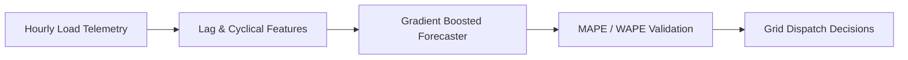

# Energy Demand Forecasting: Smart Grid Load Prediction


A machine learning system for predicting power grid electricity demand, incorporating cyclical calendar features, weather sensitivity, and rolling window cross-validation.

## Pipeline Architecture


## Run Forecaster
```bash
python src/cli/forecast_cli.py --horizon 12
```
